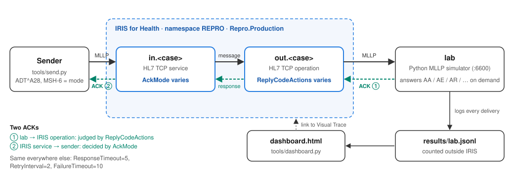
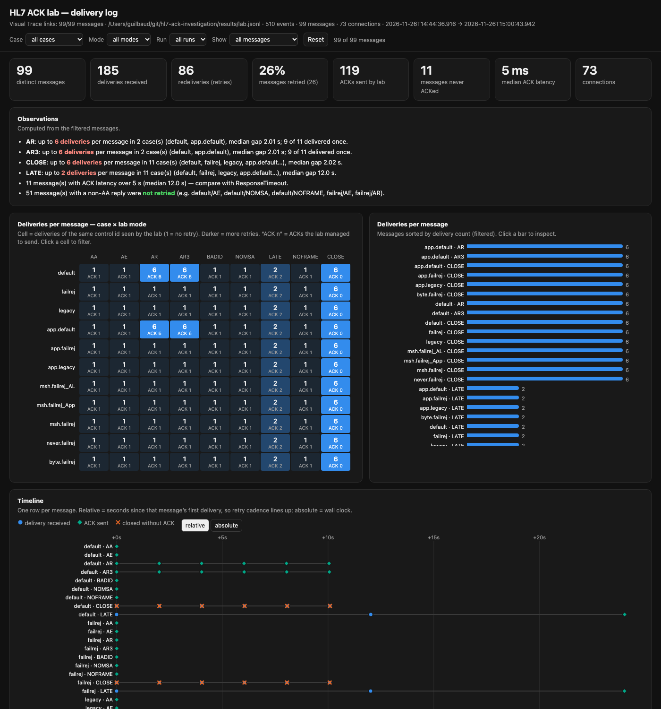
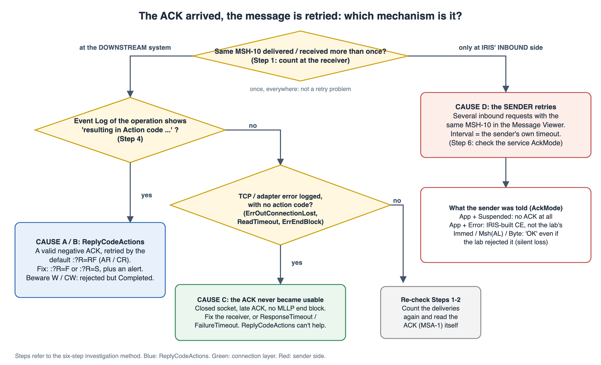

# The ACK arrived — why is my HL7 message still being retried?

Standalone lab for the InterSystems Developer Community article. Everything is synthetic.

**The article: [docs/article.md](docs/article.md)** — symptom, six-step investigation method, the four causes, test matrix.
This README is the lab's manual.



```
sender ──MLLP──▶ in.<case> ──▶ out.<case> ──MLLP──▶ lab (Python simulator, :6600)
 (tools/send.py)  HL7 TCP service  HL7 TCP operation     answers AA/AE/AR/… on demand
                  AckMode varies   ReplyCodeActions varies
```

* **IRIS**: `irishealth-community:latest-cd` (set `IRIS_IMAGE` in `.env`; pin a tag for reproducibility).
  Built at image time: namespace `REPRO`, production `Repro.Production` auto-started. `_SYSTEM`/`SuperUser` password `SYS`.
* **lab** (`simulator/lab.py`): stdlib-only MLLP receiver. It reads **MSH-6** of what it receives and misbehaves accordingly,
  and logs every delivery to `results/lab.jsonl` — so "how many times was it sent" is counted *outside* IRIS.
* **Repository layout**

  | path | content |
  |---|---|
  | `docker-compose.yml`, `iris/` | the IRIS for Health image (built with the code and the production) and the `lab` container |
  | `iris/src/Repro/` | `Production.cls` (generated), `Trace.cls` (read-only investigation helpers) |
  | `simulator/lab.py` | the downstream receiver |
  | `tools/` | `send.py` (sender), `matrix.py` (99-row matrix), `dashboard.py` (view of the lab log), `gen_production.py` |
  | `test/` | 6 scripts / 24 tests, each writing a Markdown report |
  | `results/` | the committed reference run the article quotes; `results/dashboard/` (git-ignored) holds your own runs: `lab<date>.jsonl`, `dashboard<date>.html`, `sessions<date>.json` (see Caveats) |
  | `docs/` | the article, its images (`docs/img/`), and the reference run (`docs/reports/`, `docs/traces/`, `docs/matrix.md`) |

* One service/operation pair per `ReplyCodeActions` variant; all other settings are identical
  (`ResponseTimeout=5`, `RetryInterval=2`, `FailureTimeout=10`, `ArchiveIO=1` on every item).

| case | `ReplyCodeActions` |
|---|---|
| `default` | empty → documented default `:?R=RF,:?E=S,:~=S,:?A=C,:*=S,:I?=W,:T?=C` |
| `failrej` | `:?R=F,:?E=S,:~=S,:?A=C,:*=S,:I?=W,:T?=C` (only change: `RF` → `F`) |
| `legacy`  | `:?R=W,:?E=W,:~=F,:?A=C,:T?=C,:*=F` (an "inherited" string) |

Two things vary independently. **ReplyCodeActions** (operation, how IRIS reacts to the lab's ACK) and
**AckMode** (service, what the *sender* gets back):

| service | port | AckMode | operation |
|---|---|---|---|
| `in.default` / `in.failrej` / `in.legacy` | 29201-29203 | `Immed` | `out.default` / `out.failrej` / `out.legacy` |
| `in.app.default` / `in.app.failrej` / `in.app.legacy` | 29211-29213 | `App` | same three operations |
| `in.msh.failrej` | 29214 | `Msh` (MSH-15/16 of the message decide) | `out.failrej` |
| `in.never.failrej` | 29215 | `Never` | `out.failrej` |
| `in.byte.failrej` | 29216 | `Byte` | `out.failrej` |

## Run it

**Prerequisites:** Docker with Compose v2, and Python 3 on the host (standard library only, nothing to install). The first
build also downloads the IRIS for Health image (about 4.7 GB).
**One stack at a time:** the containers are named `hl7ack-iris` / `hl7ack-lab` and use fixed ports (9772, 29201-29216). If
another checkout of this repository is running, stop it first (`docker compose down` in *its* directory).

### 1. Start the stack

```bash
docker compose up -d --build
```
Builds the IRIS image (namespace `REPRO`, production `Repro.Production` with its 11 services, auto-started) and starts two
containers: `hl7ack-iris` (IRIS) and `hl7ack-lab` (the downstream receiver, port 6600). Allow about 2 minutes the first time.
Check that the production is running (the last number must be `1`):

```bash
printf 'write ##class(Ens.Director).GetProductionStatus(.n,.s)," ",n," ",s,!\nhalt\n' | docker exec -i hl7ack-iris iris session IRIS -U REPRO
```

Expected output, the production is running (status `1`):

```text
1 Repro.Production 1
```

The `halt` at the end of the piped input closes the IRIS terminal session; without it IRIS prints `<ENDOFFILE>` and `<ERRTRAP>` when the input runs out.

The Management Portal is at http://localhost:9772/csp/sys/UtilHome.csp (namespace `REPRO`, user `_SYSTEM`, password `SYS`).

### 2. Send one message

```bash
python3 tools/send.py localhost 29201 AR demo-1
```
* `PORT` selects the inbound service, hence the `ReplyCodeActions` / `AckMode` variant (table above): 29201 = `default`.
* `MODE` is written into MSH-6 and tells the **lab how to answer**: `AA AE AR AR3`(AR with MSH-9 `ACK^A28^ACK`)
  `OTHERID`(AA whose MSA-2 is the control id of *another* message) `NOMSA` `NOFRAME`(no MLLP end block)
  `CLOSE`(socket closed, no ACK) `LATE`(AA after 12 s).
* `CONTROL_ID` becomes MSH-10. Use a **new one each time**: it is the key to find the message everywhere below.

The script prints the message sent and the ACK the *sender* gets back, here IRIS's own `MSA|CA` (service `AckMode=Immed`),
**not** the lab's `AR`. The other services behave differently, and two of them need extra settings:

Port 29211 is the `App` service. `SEND_WAIT=15` makes the sender wait up to 15 s for an answer:

```bash
SEND_WAIT=15 python3 tools/send.py localhost 29211 AR demo-2
```

Port 29214 is the `Msh` service. The two extra arguments are MSH-15 (`AL`) and MSH-16 (`NE`):

```bash
python3 tools/send.py localhost 29214 AR demo-3 AL NE
```

### 3. Count the deliveries at the receiver (outside IRIS)

Count how many times the lab received the message `demo-1`. Wait about 10 s after sending it, because the retries take that long:

```bash
grep '"control_id": "demo-1"' results/dashboard/$(cat results/dashboard/.lab-current) | grep -c '"received"'
```

Expected output, the lab received the same message 6 times:

```text
6
```

The lab appends every message it receives and every ACK it sends to its own log, `results/dashboard/lab<YYYY-MM-DD>.jsonl`
(`.lab-current` holds the name of the live file). Six deliveries two seconds apart is the symptom of the article.

### 4. Read what IRIS recorded

```bash
printf 'do ##class(Repro.Trace).Report("demo-1")\nhalt\n' | docker exec -i hl7ack-iris iris session IRIS -U REPRO
```
Prints the message headers and the Event Log of that message. Look for `... resulting in Action code RF` (the retry
decision of `ReplyCodeActions`) and the final `ErrFailureTimeout`. The same data is in the Management Portal
(Visual Trace and Event Log), and one click away from the dashboard (step 6).

### 5. Run the automated tests

Run all 6 scripts (24 tests, about 3 minutes):

```bash
test/run_all.sh
```

Or only some of them, here scripts 1 and 4:

```bash
test/run_all.sh 1 4
```

Each test sends messages, checks the deliveries and the final status, and writes a Markdown report to `results/reports/`
(index in `results/reports/README.md`). Run **one at a time**: a second `run_all.sh` refuses to start, because the
operations are single-threaded and concurrent runs would delay and mix each other's messages. Details in *Tests* below.

### 6. Open the dashboard

```bash
python3 tools/dashboard.py --open
```
Turns the lab's log into one page, `results/dashboard/dashboard<YYYY-MM-DD>.html` (`run_all.sh` also builds it when it
ends). Details in *Dashboard over the receiver's log* below.

### 7. Optional: the full matrix (about 20 minutes)

```bash
python3 tools/matrix.py --out results/dashboard/matrix.md
```
Sends every lab mode through every one of the 11 services (99 messages) and writes the table. **Always pass `--out`**: the
default, `results/matrix.md`, is the committed reference the article quotes, and a run overwrites it.

### 8. Stop

```bash
docker compose down
```
`tools/gen_production.py` regenerates `Production.cls` from its CASES table if you want to add a service or change a setting;
then rerun step 1.

### Dashboard over the receiver's log

Build the page from the lab's current log, `results/dashboard/dashboard<YYYY-MM-DD>.html` (self-contained), and open it:

```bash
python3 tools/dashboard.py --open
```

Or serve it live: reload the page in the browser to re-read the current log (default port 8765):

```bash
python3 tools/dashboard.py --serve
```

To look at the committed reference run without touching it, read `results/lab.jsonl` without querying IRIS and write the
page outside the repository:

```bash
python3 tools/dashboard.py --no-fetch -i results/lab.jsonl -o /tmp/reference.html
```



Per message: deliveries, gaps, ACKs per delivery; a *trace ↗* link opens its Visual Trace (the session id is fetched from the
running container and cached in `results/dashboard/sessions<YYYY-MM-DD>.json`, one cache per log; options `--portal`, `--ns`, `--container`, `--no-fetch`).
It only sees what the downstream receiver saw, so it cannot show retries made by the *sender* (Cause D in the article).

## Tests (`test/`)

Six scripts, 24 tests, each one sends a synthetic message, then writes a **Markdown report**: what was sent, the ACK the sender got,
what the lab received/answered, the IRIS trace, and a PASS/FAIL verdict against the expected behaviour.

| script | shows |
|---|---|
| `case_1_reject_is_retried` | the symptom: `AR` / `ACK^A28^ACK` retried under the default |
| `case_2_corrected` | `:?R=F`: same ACK, one delivery |
| `case_3_swallowed_rejection` | the legacy string hides the rejection (`CW`) |
| `case_4_ack_not_recognised` | unframed, dropped and late ACKs: retry without any `Action code` |
| `case_5_ack_content_checks` | `AE`, no MSA, an ACK for another message (MSA-2 mismatch) under the default |
| `case_6_ackmode` | `AckMode` `App` / `Msh` / `Never` / `Byte`: what the **sender** receives (the lab's real ACK or not) |

Run all scripts (about 3 minutes). One Markdown report per script goes to `results/reports/*.md`, with an index in `results/reports/README.md`:

```bash
test/run_all.sh
```

Run only selected scripts, here 1 and 4:

```bash
test/run_all.sh 1 4
```

Run a single script directly: its report is printed on stdout instead of being written to a file:

```bash
python3 -I test/case_2_corrected.py
```

A reference run is committed in `docs/reports/`.

## The investigation, in the order that worked

Detailed in [the article](docs/article.md#3-the-investigation-method-six-steps); in short:

1. **Count deliveries at the receiver**, not in IRIS (`results/lab.jsonl`, or the dashboard). Is it really being resent, at what interval, and was each delivery ACKed?
2. **Look at what the receiver actually answered** (`MSA-1`, `MSA-2`, `MSH-9`) — the ACK the *sender* sees from IRIS (`MSA|CA`, `AckMode=Immed`) is a different ACK.
3. **Follow the message in IRIS**: Visual Trace / Message Viewer (or `Repro.Trace.Report`).
4. **Read the Event Log of the session.** `matched ReplyCodeActions … resulting in Action code XX` ⇒ read `ReplyCodeActions`; a TCP/adapter error with *no* action code ⇒ connection layer.
5. **Check the effective `ReplyCodeActions`** (blank ≠ nothing: blank means the default string above) and remember: entries are evaluated left to right, **the first non-warning match wins**.
6. **Check what the sender was told** (`AckMode` of the service). Only then change a setting, and re-run the matrix.



## Results (2026.3.0.212, see `docs/matrix.md`, traces in `docs/traces/`)

| lab answers | `default` | `failrej` | `legacy` |
|---|---|---|---|
| AA | 1 delivery, Completed | same | same |
| AE | 1, Suspended (`S`) | same | 1, Completed (`CW`) |
| **AR** | **6 deliveries**, Error (`RF`, retried until FailureTimeout) | **1**, Error (`F`) | 1, Completed (`CW`) — rejection silently accepted |
| **AR3** (`ACK^A28^ACK`) | **6**, Error | **1**, Error | 1, Completed (`CW`) |
| AA for another message (MSA-2 mismatch) | 1, Completed, **no warning** (`:?A=C` matches before `:I?=W`) | same | same |
| no MSA | 1, Suspended | same | 1, Error (`F`) |
| ACK without MLLP end block | 1, Error `ErrEndBlock`, no retry | same | same |
| socket closed, no ACK | **6**, Error (connection-loss retry) | **6** | **6** |
| ACK after 12 s (> ResponseTimeout 5) | **2**, Error (timeout, retried once before FailureTimeout) | **2** | **2** |

### What the sender gets (`AckMode`), 2026.3 — `case_6`

| AckMode | lab answers | operation result | sender receives |
|---|---|---|---|
| `Immed` | anything | anything | IRIS' own `MSA|CA`, immediately — the lab's ACK is never seen |
| `App` | AA | Completed | **the lab's real ACK** (MSH-3 `LAB`) |
| `App` | AR, default | Error after 6 deliveries | IRIS-built `MSA|CE` after ~10 s (log: *Constructing ACK with code CE because SendRequestSync() … returned with no response object*) |
| `App` | AR, `:?R=F` | Error, 1 delivery | IRIS-built `MSA|CE` at once |
| `App` | AR, legacy string | Completed (`CW`) | **the lab's real `AR`** |
| `App` | AE, suspended (`S`) | Suspended | **nothing** (observed ≥ 100 s) — a sender with its own timeout will resend |
| `Msh` | AR | Error | `CA` if MSH-15=AL, IRIS-built `CE` if MSH-16=AL, nothing if neither |
| `Never` | AR | Error | nothing |
| `Byte` | AR | Error | one `0x06` byte ("OK") |

So the real downstream ACK only reaches the sender when the operation *completes*; a failure replaces it with a synthetic `CE`,
and a suspension replaces it with silence — which is another way a message ends up resent, this time by the sender.

Takeaways: three different causes of "ACK arrived, still retried" — (a) an `AR` under the default `:?R=RF`;
(b) an ACK IRIS never recognised as one (late, unframed, connection dropped) which is retried by the adapter's
connection logic, **not** by ReplyCodeActions (no `Action code` in the log); (c) copying `R` into a custom string.
`failrej` fixes only (a); (b) needs the receiver or `ResponseTimeout` fixed.

## Caveats
* Tested on `latest-cd` = **2026.3**
* `F` on AR leaves the message in Error and the sender is not told (`AckMode=Immed`); alerting/resubmit is a business decision, not shown here.
* Extra `RF` / `F` entries in the matrix's "action codes logged" column are log lines that *quote* the action (the final "Discarding message" line, or the service's "Constructing ACK with code CE" warning), not extra deliveries; the **deliveries** column is the receiver's count.
* **Reference vs. your own runs.** `results/lab.jsonl`, `results/dashboard.html`, `results/sessions.json` and `results/matrix.md` are the committed reference the article quotes; nothing in the lab writes to them. A fresh install (or any new lab container) logs to its **own** `results/dashboard/lab<YYYY-MM-DD>.jsonl` (the lab records the name in `results/dashboard/.lab-current`; a same-day restart appends to the same file), and `test/run_all.sh` ends (also when it fails or is cancelled with Ctrl-C) by building `results/dashboard/dashboard<YYYY-MM-DD>.html` and `results/dashboard/sessions<YYYY-MM-DD>.json` from it, so the Visual Trace links match *your* IRIS container, not the reference one. **`results/dashboard/` is git-ignored**: your own runs never end up in the repository. After `docker compose down -v`, empty `results/dashboard/` for a clean log.
* `test/run_all.sh` still rewrites `results/reports/` and `tools/matrix.py` still writes `results/matrix.md` (use `--out` to keep the reference); `docs/reports/`, `docs/traces/` and `docs/matrix.md` keep the reference copies.
* A `LATE` ACK stays in the operation's socket and IRIS logs *"Discarding data found in buffer before HL7 send"* on the next send. That is IRIS discarding a stale ACK on purpose; the test harness and `tools/matrix.py` reset the operation's connection after every `LATE` run (`Repro.Trace.ResetOperation`) so it does not leak into other tests.

## License

[MIT](LICENSE). The InterSystems IRIS for Health image used by the lab is subject to its own license terms.
