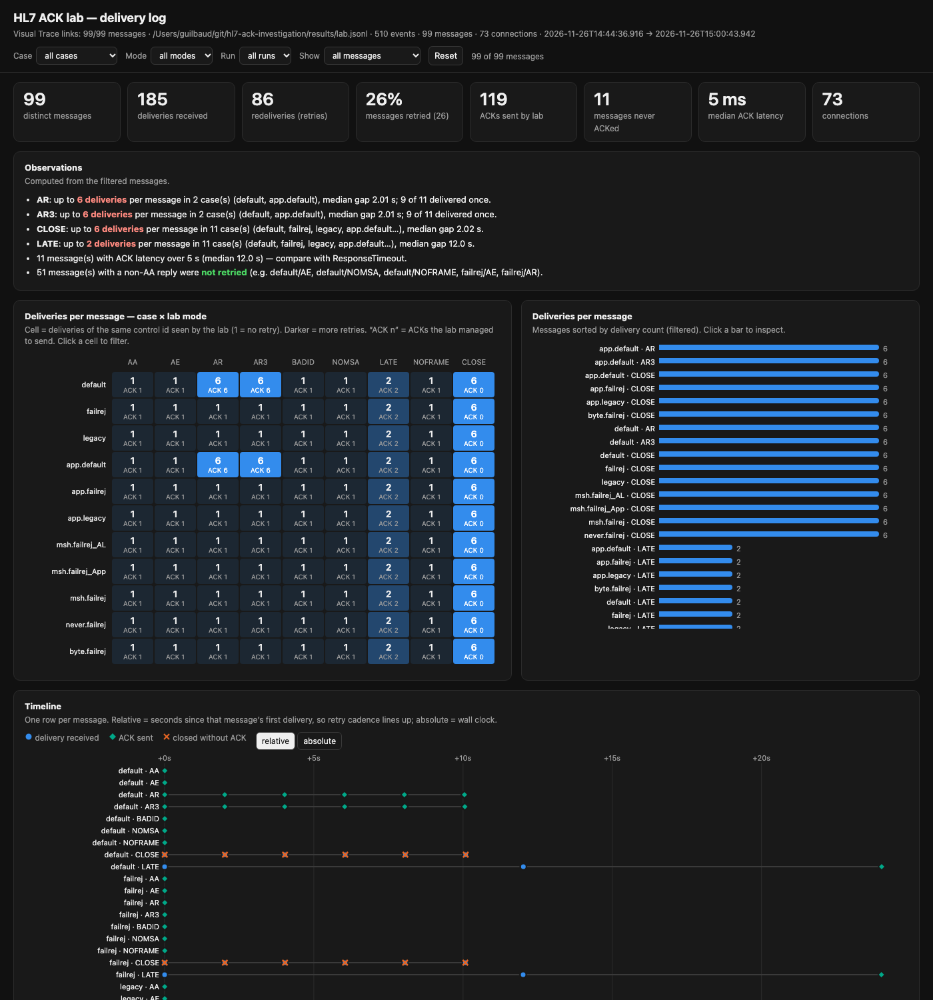

# L'ACK est bien arrivé — pourquoi mon message HL7 est-il quand même rejoué dans InterSystems IRIS for Health | Health Connect ?

*Testé avec l'image InterSystems IRIS for Health community `latest-cd` (2026.3.0.212). Tous les messages sont synthétiques. Le laboratoire complet ([Docker Compose](../docker-compose.yml), [simulateur](../simulator/lab.py), [production](../iris/src/Repro/Production.cls), 24 [tests scriptés](../test/) avec leurs [rapports](reports/README.md), et un [tableau de bord](../tools/dashboard.py) sur le journal du récepteur) se trouve dans le dépôt associé ; voir le [README](../README.md).*

## 1. Le symptôme

Une opération HL7 TCP envoie un `ADT^A28` à un système aval. Le système aval **répond bien** : la trace TCP montre un ACK bien formé. Pourtant, le même message continue d'arriver côté récepteur, toutes les quelques secondes, et finit par passer en *Error*.

« L'ACK est arrivé » et « le message est rejoué » semblent contradictoires. Ils ne le sont pas, et cet article propose une méthode reproductible pour déterminer lequel de **quatre mécanismes différents** est à l'œuvre *avant* de toucher à un paramètre de production. La méthode part de **ce que le récepteur a vu**, lu à travers un petit tableau de bord, et ne passe qu'ensuite dans IRIS.

## 2. Le laboratoire en une image


* Le **lab** ([`simulator/lab.py`](../simulator/lab.py)) lit le MSH-6 de ce qu'il reçoit et répond en conséquence (`AA`, `AE`, `AR`, `AR3` = AR avec `MSH-9 = ACK^A28^ACK`, un ACK pour *un autre* message (`MSA-2` ≠ `MSH-10` d'origine), pas de MSA, pas de fin de bloc MLLP, socket fermée, délai de 12 secondes). L'émetteur est [`tools/send.py`](../tools/send.py). Le lab journalise aussi chaque livraison, si bien que *combien de fois le message a été envoyé* est compté **en dehors d'IRIS**.
* Trois opérations (définies dans [`Production.cls`](../iris/src/Repro/Production.cls), générées par [`tools/gen_production.py`](../tools/gen_production.py)) ne diffèrent **que** par `ReplyCodeActions` (tout le reste : `ResponseTimeout=5`, `RetryInterval=2`, `FailureTimeout=10`) :

| opération | `ReplyCodeActions` |
|---|---|
| `out.default` | vide → valeur par défaut documentée `:?R=RF,:?E=S,:~=S,:?A=C,:*=S,:I?=W,:T?=C` |
| `out.failrej` | identique, `:?R=RF` → `:?R=F` |
| `out.legacy` | `:?R=W,:?E=W,:~=F,:?A=C,:T?=C,:*=F` (une chaîne « héritée ») |

* Les services placés devant elles ne diffèrent que par `AckMode` (`Immed`, `App`, `Msh`, `Never`, `Byte`).

## 3. La méthode d'investigation (six étapes)

Chaque étape répond à une question et indique où regarder. Suivez-les dans l'ordre ; arrêtez-vous dès que vous pouvez expliquer le comportement.

### Étape 1 — Le message est-il vraiment *renvoyé* ? Compter côté récepteur, avec le tableau de bord

Ne commencez pas dans IRIS. Demandez au système récepteur (ou capturez le trafic) combien de fois le **même MSH-10** est arrivé, à quel intervalle, et si chaque livraison a reçu un ACK. Dans le lab, cet enregistrement est [`results/lab.jsonl`](../results/lab.jsonl), écrit par [`lab.py`](../simulator/lab.py) et indépendant d'IRIS. [`tools/dashboard.py`](../tools/dashboard.py) le transforme en une seule page :

```bash
python3 tools/dashboard.py --open      # écrit results/dashboard.html
python3 tools/dashboard.py --serve     # en direct : rechargez la page pour relire le journal
```



L'exécution complète de la matrice ([`results/matrix.md`](../results/matrix.md)) a produit **99 messages distincts** et **185 livraisons** : 86 d'entre elles étaient des re-livraisons, réparties sur 26 messages (26 %). Le lab a envoyé 119 ACK, et 11 messages n'en ont jamais reçu. Le panneau d'observations l'énonce par mode du lab ; la carte de chaleur (lignes = cas `ReplyCodeActions`/`AckMode`, colonnes = ce qu'a fait le lab) montre *où*. Chaque cellule indique le nombre de livraisons et, en dessous, combien d'ACK le lab a réussi à envoyer.

| ce que montre le tableau de bord | lecture | mène à |
|---|---|---|
| `AR` et `AR3` : **6 livraisons**, écart médian **2,01 s**, **`ACK 6`** — mais seulement dans les lignes `default` et `app.default` ; toutes les autres lignes valent `1` | chaque livraison *a bien reçu* un ACK, de code négatif ; l'écart est égal à `RetryInterval`, et le nombre ne dépend que de `ReplyCodeActions` | Cause A, B, B' |
| `CLOSE` : **6 livraisons**, écart médian **2,02 s**, **`ACK 0`** — dans *toutes* les lignes | même nombre et même cadence que `AR`, mais rien n'a jamais été répondu, et aucune variante de `ReplyCodeActions` n'y change rien | Cause C |
| `LATE` : **2 livraisons**, **`ACK 2`**, écart médian **12,0 s**, latence d'ACK 12 s | les ACK sont valides mais arrivent après `ResponseTimeout` (5 s) ; l'écart n'est pas `RetryInterval` | Cause C |
| 51 messages avec une réponse autre que `AA`, **non rejoués** (`AE`, pas de MSA, `NOFRAME`, `AR` sous `failrej`/`legacy`…) | une seule livraison ne prouve pas le succès : IRIS a pu suspendre, échouer ou « terminer avec avertissement » | Autres contenus d'ACK, Cause B/B', ligne `NOFRAME` de la Cause C |

Deux choses que cette vue rend évidentes et qu'un journal brut cache :

* **Le nombre de livraisons seul n'identifie pas le mécanisme.** `AR` sous la configuration par défaut et `CLOSE` donnent tous deux 6 livraisons espacées de deux secondes. C'est le *nombre d'ACK sous le nombre de livraisons* qui les distingue (`ACK 6` contre `ACK 0`) : dans le premier cas le récepteur a répondu à chaque fois, dans le second jamais.
* **Le motif sur l'ensemble des lignes est le diagnostic.** `AR` est rejoué dans deux lignes et pas dans les autres : le rejeu est donc une propriété du *paramétrage de l'opération*. `CLOSE` et `LATE` sont rejoués dans toutes : c'est une propriété de la *connexion*.

Un intervalle régulier égal au `RetryInterval` de l'opération, qui s'arrête à `FailureTimeout` (ici ≈ 10 s : la vue relative de la chronologie aligne les rejeux à +2, +4, +6, +8, +10 s), désigne la **boucle de rejeu de l'opération**. Un intervalle qui correspond au délai d'attente *de l'émetteur* désigne autre chose (voir §6, Cause D). Le tableau de bord ne peut pas montrer ce dernier cas : il ne voit que le récepteur aval, la Cause D se vérifie donc côté entrant dans IRIS (Étape 3).

Les lignes brutes derrière la chronologie, si vous n'avez pas de tableau de bord :

```
11:34:40.284 received  t-ar-1
11:34:42.290 received  t-ar-1     <- toutes les 2 s = RetryInterval
11:34:44.298 received  t-ar-1
...                               <- s'arrête après ~10 s = FailureTimeout
```

Sélectionnez une ligne du tableau *Messages* (ou une barre, ou une étiquette de la chronologie) pour voir les événements du message avec le temps écoulé depuis la première livraison et depuis la précédente. Son lien **trace ↗** ouvre directement le Visual Trace de ce message (étapes suivantes).

### Étape 2 — Qu'a exactement répondu le récepteur ?

Regardez l'ACK lui-même, champ par champ : `MSA-1` (code), `MSA-2` (identifiant de contrôle), `MSH-9` (type), encadrement MLLP.

```
MSH|^~\&|LAB|SIM|IRIS|HOSP|20261126113438||ACK|ACKt-ar-1|P|2.5
MSA|AR|t-ar-1|Rejected
```

`MSA|AR` est un ACK parfaitement valide. C'est un **accusé de réception négatif**, et « arrivé » ne veut pas dire « accepté ». Notez le `MSA-1` avant de lire le moindre paramètre IRIS.

> **Deux ACK, ne les confondez pas.** L'ACK que *votre émetteur* reçoit d'IRIS n'est pas celui que le lab a envoyé. Avec `AckMode=Immed`, l'émetteur reçoit toujours le `MSA|CA` propre à IRIS, quelle que soit la réponse du lab.

### Étape 3 — Suivre le message dans IRIS (Visual Trace et Message Viewer)

Dans le Management Portal, namespace de votre production : **Interoperability → View → Messages**, trouvez le message entrant (recherche sur la session de l'en-tête, ou sur l'identifiant de contrôle HL7 avec une table de recherche), puis ouvrez **Visual Trace**.

Depuis le tableau de bord, c'est un clic : le lien *trace ↗* d'un message (dans le tableau Messages, le panneau de détail et les événements bruts) ouvre `…/csp/healthshare/<namespace>/EnsPortal.VisualTrace.zen?SESSIONID=<id>`. Le tableau de bord obtient l'identifiant de session en interrogeant le conteneur en cours d'exécution sur la session dont la requête entrante a `MSH-10` = l'identifiant de contrôle (aucune configuration supplémentaire ; le résultat est mis en cache dans `results/sessions.json` ; options `--portal`, `--ns`, `--container`, `--no-fetch`).

Ce qu'il faut lire :

* la **requête** `in.xxx → out.xxx` et son statut final (*Completed*, *Error*, *Suspended*, *Discarded*…) ;
* une **réponse** `out.xxx → in.xxx` lorsque le service en attend une (`AckMode=App`) ;
* le **nombre de réponses** stockées pour l'opération (une par tentative ayant reçu un ACK ; `ArchiveIO=1` sur les éléments permet d'inspecter les E/S brutes).

Dans le lab, la même information est affichée par `Repro.Trace.Report("<control id>")` ([`Trace.cls`](../iris/src/Repro/Trace.cls)) ; c'est un simple SQL sur `Ens.MessageHeader` et `Ens_Util.Log` filtré sur l'identifiant de session.

### Étape 4 — Lire l'Event Log de cette session — c'est là qu'est la réponse

**Interoperability → View → Event Log**, filtrez sur le nom de configuration de l'opération, ou naviguez depuis le Visual Trace. Deux types de lignes comptent, et elles se distinguent facilement :

**(a) Une ligne contenant `resulting in Action code …`** — la décision vient de `ReplyCodeActions` :

```
ERROR [out.default] ERROR <Ens>ErrGeneral: Retrying HL7 Message body 10@EnsLib.HL7.Message / 1
  because response 13@EnsLib.HL7.Message / 2
  MSA code 'AR' matched ReplyCodeActions 1-6 : ':?R=RF,:?E=S,:~=S,:?A=C,:*=S,:I?=W',
  resulting in Action code RF : MSH|^~\&|LAB|SIM|IRIS|HOSP|...||ACK|ACKt-ar-1|P|2.5 MSA|AR|t-ar-1|Rejected
```

Elle vous dit *quelle* entrée s'est déclenchée (`1-6` est le bloc contigu des entrées `:` ; la chaîne entre apostrophes est le paramètre **effectif**, que vous n'avez peut-être pas saisi vous-même), *quel* ACK l'a déclenchée (identifiant de la réponse et contenu brut) et *quelle* action a été prise (`RF` = **R**etry, puis **F**ail à la fin).

La séquence se termine par :

```
ERROR [out.default] ERROR <Ens>ErrGeneral: Discarding message on ERROR <Ens>ErrFailureTimeout:
  FailureTimeout of 10 seconds exceeded in EnsLib.HL7.Operation.TCPOperation; status from last attempt was ...
```

**(b) Une ligne d'erreur TCP/adaptateur sans code d'action** — la décision vient de l'adaptateur, pas de `ReplyCodeActions` :

```
ERROR <Ens>ErrTCPTerminatedReadTimeoutExpired: TCP Read timeout (5) expired waiting for terminator ...
ERROR <Ens>ErrOutConnectionLost: Lost HL7 Read connection to lab:6600 ...
ERROR <EnsEDIHL7>ErrEndBlock: Received unexpected EndBlock '' in input "", expected 'er ...
```

> **Règle pratique :** *code d'action dans le journal ⇒ lisez `ReplyCodeActions` ; pas de code d'action ⇒ lisez les paramètres de connexion et le comportement du récepteur.*

### Étape 5 — Résoudre le `ReplyCodeActions` effectif

**Interoperability → Configure → Production**, sélectionnez l'opération, **Settings → Additional Settings → Reply Code Actions**.

* **Vide ne signifie pas « aucune règle »** : cela signifie la valeur par défaut documentée `:?R=RF,:?E=S,:~=S,:?A=C,:*=S,:I?=W,:T?=C`. Cette valeur rejoue sur `AR`/`CR` — par conception.
* Les entrées sont évaluées **de gauche à droite et la première correspondance qui n'est pas un simple avertissement l'emporte**. Les entrées dont l'action est seulement `W` sont évaluées et journalisées mais n'arrêtent pas la recherche. Conséquence, vérifiée dans le lab (mode `OTHERID`) : un `AA` dont le `MSA-2` est l'identifiant de contrôle d'*un autre* message — un ACK périmé ou mal routé, donc *pas* l'accusé du message que vous avez envoyé — est accepté en silence : le message se termine et rien n'est journalisé, car `:?A=C` correspond avant que `:I?=W` ne soit atteint. Ce n'est pas un cas de rejeu ; c'en est l'image inverse (un faux succès). Si vous voulez que le contrôle de l'identifiant agisse, placez `:I?` *avant* `:?A` (je n'ai pas testé cet ordre).
* Lettres d'action : `C` terminé, `W` avertissement, `R` rejeu (jusqu'à `FailureTimeout`, toutes les `RetryInterval`), `S` suspendre, `D` désactiver l'opération, `F` échec. Elles se combinent (`RF`, `RD`, `CW`).

### Étape 6 — Vérifier ce qu'a reçu l'*émetteur* (AckMode du service)

Ouvrez l'`AckMode` du service entrant. Il décide de l'ACK que voit votre système amont, et donc si *lui* peut rejouer. Voir §6.

## 4. Les cas, un par un

Tous les chiffres ci-dessous proviennent des tests scriptés ([`test/`](../test/), rapports dans [`docs/reports/`](reports/README.md), traces brutes dans [`docs/traces/`](traces/)), 2026.3, `FailureTimeout=10`, `RetryInterval=2`, `ResponseTimeout=5`.

### Cause A — Un ACK négatif valide, sous un `ReplyCodeActions` qui rejoue (la valeur par défaut)

Test : [`case_1_reject_is_retried.py`](../test/case_1_reject_is_retried.py) → [rapport](reports/case_1_reject_is_retried.md).

| le lab répond | livraisons | statut final | journal |
|---|---:|---|---|
| `MSA\|AR`  | **6** | Error | `... Action code RF` ×6, puis `ErrFailureTimeout` |
| `MSA\|AR`, `MSH-9 = ACK^A28^ACK` | **6** | Error | idem |

Rien n'est cassé : la valeur par défaut **est** `:?R=RF`. Le `ACK^A28^ACK` à trois composants est une fausse piste — c'est un `MSH-9` valide et ce n'est pas `:T?` (contrôle du type) qui s'est déclenché.

*Vérifier :* l'Étape 4(a) montre `RF`. *Décider :* un renvoi identique va-t-il un jour faire changer d'avis le récepteur ? En général non.

### Cause B — Corriger la Cause A

Test : [`case_2_corrected.py`](../test/case_2_corrected.py) → [rapport](reports/case_2_corrected.md).

Changez seulement `:?R=RF` → `:?R=F` :

| le lab répond | livraisons | statut final | journal |
|---|---:|---|---|
| `MSA\|AR` | **1** | Error | `Quitting with error ... Action code F` |
| `MSA\|AA` (témoin) | 1 | Completed | — |

Le rejet est désormais **visible une fois** au lieu d'être caché derrière dix secondes de rejeux. `S` (suspendre) est l'alternative si vous voulez renvoyer à la main. Ajoutez dans tous les cas une alerte sur l'opération : `F` laisse le message en *Error* et, avec `AckMode=Immed`, l'émetteur n'en est pas informé.

### Cause B' — Le « correctif » qui cache le problème

Test : [`case_3_swallowed_rejection.py`](../test/case_3_swallowed_rejection.py) → [rapport](reports/case_3_swallowed_rejection.md).

La chaîne héritée `:?R=W,:?E=W,:~=F,:?A=C,:T?=C,:*=F` arrête elle aussi les rejeux :

| le lab répond | livraisons | statut final | action |
|---|---:|---|---|
| `AR` | 1 | **Completed** | `CW` |
| `AE` | 1 | **Completed** | `CW` |
| pas de MSA | 1 | Error | `F` |

Le message est marqué *Completed* alors que le récepteur l'a rejeté ; il ne reste qu'un avertissement. Acceptable si les rejets ne demandent vraiment aucune action chez vous, dangereux sinon.

### Cause C — L'ACK est arrivé dans IRIS mais n'est jamais devenu un ACK exploitable

Test : [`case_4_ack_not_recognised.py`](../test/case_4_ack_not_recognised.py) → [rapport](reports/case_4_ack_not_recognised.md) ; traces : [socket fermée](traces/default-CLOSE-124218.txt), [ACK tardif](traces/default-LATE-124218.txt), [pas de fin de bloc](traces/default-NOFRAME-124218.txt).

Pas de code d'action dans le journal ; le rejeu vient de l'adaptateur TCP, qui positionne l'indicateur `Retry` de l'opération sur les erreurs réseau (documenté dans la référence de classe de `ReplyCodeActions`).

| ce qu'a fait le récepteur | livraisons | final | signature dans le journal |
|---|---:|---|---|
| a fermé la socket sans ACK | **6** | Error | `ErrOutConnectionLost`, puis *Disconnecting / Opened TCP connection* répétés |
| ACK après 12 s (`ResponseTimeout` = 5) | **2** | Error | `ErrTCPTerminatedReadTimeoutExpired`, puis `ErrFailureTimeout` |
| ACK sans fin de bloc MLLP (`0x1C 0x0D`) | 1 | Error | `ErrEndBlock`, **non** rejoué |

La dernière ligne est la plus difficile à diagnostiquer : des octets *sont* arrivés, le journal du récepteur dit « ACK sent », et IRIS signale pourtant une erreur. Seule une capture de paquets ou le texte exact `ErrEndBlock` vous dit que l'encadrement est faux.

> **À propos de « Discarding data found in buffer before HL7 send ».** Si vous exécutez le lab, vous verrez peut-être cet avertissement sur une opération. C'est IRIS qui vous protège, pas une défaillance : un ACK qui arrive *après* `ResponseTimeout` reste dans la socket, et IRIS le jette la prochaine fois qu'il envoie sur cette connexion, au lieu de le prendre pour la réponse au nouveau message. Dans le lab, il apparaissait dans des tests sans rapport, car les ACK tardifs d'un test étaient encore dans la socket du suivant. Le banc de test coupe désormais la connexion de l'opération après chaque test `LATE` (`Repro.Trace.ResetOperation`) pour que chaque rapport ne montre que ses propres événements.

*Vérifier :* Étape 4(b). *Corriger :* côté récepteur (encadrement, latence de réponse) ou `ResponseTimeout`/`FailureTimeout`. Modifier `ReplyCodeActions` n'aide pas ici, hormis les entrées préfixées par `E` qui correspondent au statut d'erreur lui-même.

### Autres contenus d'ACK avec la configuration par défaut

Test : [`case_5_ack_content_checks.py`](../test/case_5_ack_content_checks.py) → [rapport](reports/case_5_ack_content_checks.md) ; trace du cas `OTHERID` : [default-OTHERID-165505](traces/default-OTHERID-165505.txt).

| le lab répond | livraisons | final | action |
|---|---:|---|---|
| `AA` | 1 | Completed | — |
| `AE` | 1 | **Suspended** | `S` |
| pas de segment `MSA` | 1 | **Suspended** | `S` |
| `AA` accusant réception d'*un autre* message (`MSA-2` différent) | 1 | Completed | aucune (voir Étape 5) |

## 5. Ce que l'émetteur reçoit réellement — `AckMode`

Jusqu'ici, l'émetteur recevait toujours le `CA` propre à IRIS (`AckMode=Immed`). Les mêmes opérations derrière des services d'autres modes (test : [`case_6_ackmode.py`](../test/case_6_ackmode.py) → [rapport](reports/case_6_ackmode.md)) :

| AckMode | le lab répond | résultat de l'opération | l'émetteur reçoit |
|---|---|---|---|
| `Immed` | n'importe quoi | n'importe quoi | le `MSA\|CA` propre à IRIS, immédiatement — l'ACK du lab n'est jamais vu |
| `App` | `AA` | Completed | **le vrai ACK du lab** (MSH-3 `LAB`) |
| `App` | `AR`, défaut | Error après 6 livraisons | un `MSA\|CE` construit par IRIS après ≈10 s |
| `App` | `AR`, `:?R=F` | Error, 1 livraison | un `CE` construit par IRIS, immédiatement |
| `App` | `AR`, chaîne héritée | Completed (`CW`) | **le vrai `AR` du lab** |
| `App` | `AE`, suspendu | Suspended | **rien** |
| `Msh` | `AR` | Error | `CA` si MSH-15=AL ; `CE` construit si MSH-16=AL ; rien sinon |
| `Never` | `AR` | Error | rien |
| `Byte` | `AR` | Error | un octet `0x06` (« OK ») |

Le journal du service explique le `CE` :

```
WARNING [in.app.default] Constructing ACK with code CE because SendRequestSync() of 8@EnsLib.HL7.Message/1
  returned with no response object and status: ERROR <Ens>ErrGeneral: Discarding message on ERROR <Ens>ErrFailureTimeout ...
```

## 6. Cause D — le rejeu n'est pas celui d'IRIS : c'est celui de l'émetteur

Si les Étapes 1 à 5 montrent **une seule** livraison vers le système aval, mais que le système *amont* continue d'envoyer le même message :

* Avec `AckMode=App`, un message **suspendu** ne produit **aucun ACK** : l'amont attend, expire, et renvoie. Dans le Message Viewer, vous verrez plusieurs messages *entrants* avec le même MSH-10, et non plusieurs tentatives d'un seul message.
* Avec `Immed`/`Msh` (`CA`), l'amont croit que le message a été *accepté* ; le rejet aval ne déclenchera jamais de rejeu amont, ce qui est le problème inverse (perte silencieuse) — à comparer avec la Cause B'.
* Avec `Byte`, l'émetteur reçoit « OK » quoi qu'il soit arrivé en aval.

*Vérifier :* comptez les messages **entrants** par MSH-10 (Étape 1 côté émetteur), et comparez l'intervalle avec le délai d'attente propre de l'émetteur.

## 7. Arbre de décision

```
Même MSH-10 reçu plus d'une fois ?
├─ côté système AVAL ?
│   ├─ l'Event Log contient "resulting in Action code ..R.."  → Cause A : ReplyCodeActions (défaut :?R=RF sur AR/CR)
│   └─ l'Event Log contient ErrTCP... / ErrOutConnectionLost / timeout, sans code d'action → Cause C : connexion/ACK jamais exploitable
└─ seulement côté ENTRANT d'IRIS (plusieurs requêtes dans le Message Viewer) ? → Cause D : l'émetteur rejoue
      └─ vérifier l'AckMode du service et si le message est passé en Suspended/Error
```

Le même arbre en image ([source SVG](img/decision-flow.svg), [PNG](img/decision-flow.png) ; le texte du schéma est en anglais) :


## 8. Comportement corrigé : la matrice de tests

Tout ce qui figure dans cet article est reproduit par (voir [`test/run_all.sh`](../test/run_all.sh) et l'[index des rapports](reports/README.md)) :

```bash
docker compose up -d --build
test/run_all.sh          # 6 scripts, 24 tests, un rapport Markdown chacun (results/reports/)
```

| script | démontre |
|---|---|
| [`case_1_reject_is_retried`](../test/case_1_reject_is_retried.py) | `AR` / `ACK^A28^ACK` rejoué avec la configuration par défaut — [rapport](reports/case_1_reject_is_retried.md) |
| [`case_2_corrected`](../test/case_2_corrected.py) | `:?R=F` : une seule livraison — [rapport](reports/case_2_corrected.md) |
| [`case_3_swallowed_rejection`](../test/case_3_swallowed_rejection.py) | la chaîne héritée cache les rejets (`CW`) — [rapport](reports/case_3_swallowed_rejection.md) |
| [`case_4_ack_not_recognised`](../test/case_4_ack_not_recognised.py) | ACK sans encadrement / abandonné / tardif — [rapport](reports/case_4_ack_not_recognised.md) |
| [`case_5_ack_content_checks`](../test/case_5_ack_content_checks.py) | `AE`, pas de MSA, ACK pour un autre message — [rapport](reports/case_5_ack_content_checks.md) |
| [`case_6_ackmode`](../test/case_6_ackmode.py) | ce que reçoit l'émetteur avec `App`, `Msh`, `Never`, `Byte` — [rapport](reports/case_6_ackmode.md) |

## 9. Fichiers de résultats

Tout ce qui suit est produit par le lab et versionné dans [`results/`](../results/) :

| fichier | contenu |
|---|---|
| [`results/lab.jsonl`](../results/lab.jsonl) | chaque message que le système aval simulé a reçu et auquel il a répondu (le comptage indépendant des livraisons) |
| [`results/dashboard.html`](../results/dashboard.html) | le même journal sur une seule page : filtres, observations, carte de chaleur cas × mode, chronologie, tableau de messages triable, liens vers le Visual Trace de chaque message (généré par [`tools/dashboard.py`](../tools/dashboard.py)) ; `results/sessions.json` est son cache identifiant de contrôle → identifiant de session |
| [`results/matrix.md`](../results/matrix.md) | les 11 services entrants (ReplyCodeActions × AckMode) × 9 comportements du lab = 99 lignes : livraisons, statut final, codes d'action **et ce que reçoit l'émetteur** ([`matrix.log`](../results/matrix.log) est sa sortie console ; généré par [`tools/matrix.py`](../tools/matrix.py)) |
| [`results/reports/README.md`](../results/reports/README.md) | index des rapports de test de la dernière exécution complète ([`run_all.log`](../results/run_all.log)) |
| [`case_1_reject_is_retried.md`](../results/reports/case_1_reject_is_retried.md) | `AR` rejoué avec la configuration par défaut |
| [`case_2_corrected.md`](../results/reports/case_2_corrected.md) | `:?R=F` |
| [`case_3_swallowed_rejection.md`](../results/reports/case_3_swallowed_rejection.md) | chaîne héritée, `CW` |
| [`case_4_ack_not_recognised.md`](../results/reports/case_4_ack_not_recognised.md) | ACK fermé / tardif / sans encadrement |
| [`case_5_ack_content_checks.md`](../results/reports/case_5_ack_content_checks.md) | `AE`, pas de MSA, ACK pour un autre message |
| [`case_6_ackmode.md`](../results/reports/case_6_ackmode.md) | `AckMode` `App`, `Msh`, `Never`, `Byte` |

Relancer le lab écrase ces fichiers ; [`docs/reports/`](reports/README.md) et [`docs/traces/`](traces/) conservent l'exécution de référence citée dans cet article.

## 10. À retenir

1. **Partez du journal du récepteur, pas d'IRIS.** Le nombre de livraisons, l'écart et les *ACK par livraison* (la carte de chaleur du tableau de bord) séparent déjà un `ReplyCodeActions` qui rejoue d'une connexion défaillante.
2. **« L'ACK est arrivé » ne dit rien de son code.** Lisez d'abord `MSA-1`.
3. **Un `ReplyCodeActions` vide, c'est la valeur par défaut, et la valeur par défaut rejoue `AR`.**
4. **Cherchez `resulting in Action code`.** Présent : `ReplyCodeActions`. Absent : comportement de l'adaptateur/de la connexion.
5. **L'ordre compte dans `ReplyCodeActions` :** la première correspondance qui n'est pas un simple avertissement l'emporte.
6. **Il existe deux ACK.** Sachez quel `AckMode` utilise votre service et ce que l'émetteur reçoit réellement.
7. **Mesurez côté récepteur avant de modifier un paramètre de production.**

## Réserves

* Testé sur 2026.3 (`latest-cd`).
* Les noms de menus du portail sont les noms habituels d'Interoperability ; vérifiez-les sur votre version.
* Le tableau de bord ne voit que ce qu'a vu le récepteur aval. Il ne peut pas montrer la Cause D (rejeux par l'émetteur amont) ni ce qu'IRIS a décidé ; utilisez pour cela le Visual Trace et l'Event Log. Les chiffres cités à l'Étape 1 du §3 proviennent d'une exécution complète de la matrice et changent si d'autres exécutions ajoutent des lignes à `lab.jsonl` (le fichier n'est jamais tronqué).
* Le simulateur est un petit serveur MLLP en Python, pas un vrai LIS ; les systèmes réels peuvent fermer les connexions inactives ou regrouper les ACK différemment.
