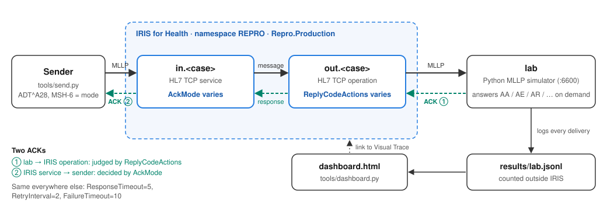
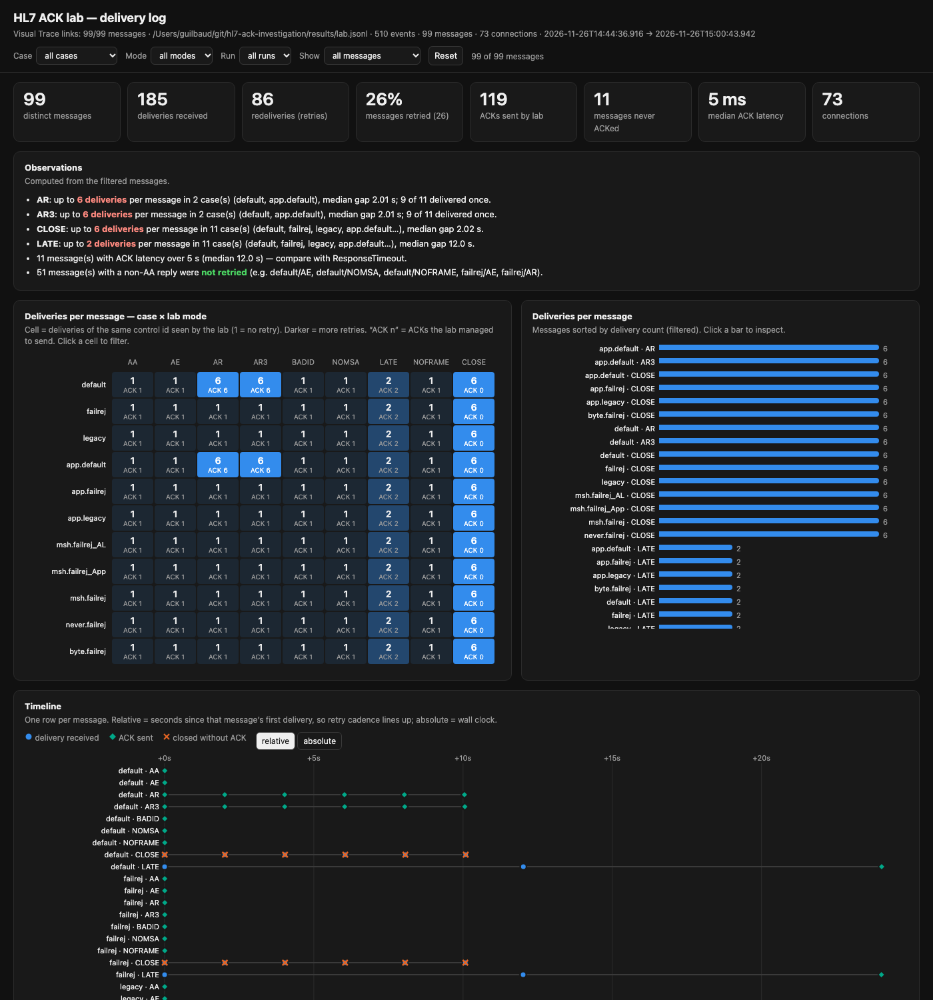

# The ACK Arrived — Why Is My HL7 Message Still Being Retried in InterSystems IRIS for Health | Health Connect?

*Tested with InterSystems IRIS for Health community image `latest-cd` (2026.3.0.212). All messages are synthetic. The full lab ([Docker Compose](../docker-compose.yml), [simulator](../simulator/lab.py), [production](../iris/src/Repro/Production.cls), 24 [scripted tests](../test/) with [reports](reports/README.md), and a [dashboard](../tools/dashboard.py) over the receiver's log) is in the companion repository; see the [README](../README.md).*

## 1. The symptom

An HL7 TCP operation sends an `ADT^A28` to a downstream system. The downstream system **does answer**: the TCP trace shows a well-formed ACK. Yet the same message keeps arriving on the receiver's side, every few seconds, and finally the message ends in *Error*.

"The ACK arrived" and "the message is retried" look contradictory. They are not, and this article gives a repeatable way to find out which of **four different mechanisms** is at work *before* touching any production setting. The method starts from **what the receiver saw**, read through a small dashboard, and only then goes into IRIS.

## 2. The lab in one picture



* The **lab** ([`simulator/lab.py`](../simulator/lab.py)) reads MSH-6 of what it receives and answers accordingly (`AA`, `AE`, `AR`, `AR3` = AR with `MSH-9 = ACK^A28^ACK`, an ACK for *another* message (`MSA-2` ≠ original `MSH-10`), no MSA, no MLLP end block, socket closed, 12-second delay). The sender is [`tools/send.py`](../tools/send.py). The lab also logs every delivery, so *how many times was it sent* is counted **outside IRIS**.
* Three operations (defined in [`Production.cls`](../iris/src/Repro/Production.cls), generated by [`tools/gen_production.py`](../tools/gen_production.py)) differ **only** in `ReplyCodeActions` (everything else: `ResponseTimeout=5`, `RetryInterval=2`, `FailureTimeout=10`):

| operation | `ReplyCodeActions` |
|---|---|
| `out.default` | empty → documented default `:?R=RF,:?E=S,:~=S,:?A=C,:*=S,:I?=W,:T?=C` |
| `out.failrej` | same, `:?R=RF` → `:?R=F` |
| `out.legacy` | `:?R=W,:?E=W,:~=F,:?A=C,:T?=C,:*=F` (an "inherited" string) |

* The services in front of them differ only in `AckMode` (`Immed`, `App`, `Msh`, `Never`, `Byte`).

## 3. The investigation method (six steps)

Each step answers one question and names where to look. Do them in this order; stop as soon as you can explain the behaviour.

### Step 1 — Is it really *re-sent*? Count at the receiver, with the dashboard

Do not start in IRIS. Ask the receiving side (or capture the traffic) how many times the **same MSH-10** arrived, at what interval, and whether each delivery got an ACK. In the lab that record is [`results/lab.jsonl`](../results/lab.jsonl), written by [`lab.py`](../simulator/lab.py) and independent of IRIS. [`tools/dashboard.py`](../tools/dashboard.py) turns it into one page:

```bash
python3 tools/dashboard.py --open      # the lab's current log -> results/dashboard/dashboard<YYYY-MM-DD>.html
python3 tools/dashboard.py --serve     # live: reload the page to re-read the log
```

The figures and screenshots below come from the **committed reference run** (`results/lab.jsonl`, `results/dashboard.html`), which nothing in the lab overwrites. A fresh install logs to its own `results/dashboard/lab<YYYY-MM-DD>.jsonl`, and `test/run_all.sh` finishes by building `results/dashboard/dashboard<YYYY-MM-DD>.html` from it, so the *trace ↗* links point to the sessions of **your** IRIS container.



The full matrix run ([`results/matrix.md`](../results/matrix.md)) produced **99 distinct messages** and **185 deliveries**: 86 of them were redeliveries, spread over 26 messages (26 %). The lab sent 119 ACKs, and 11 messages never got one. The observations panel states this per lab mode; the heatmap (rows = `ReplyCodeActions`/`AckMode` case, columns = what the lab did) shows *where*. Each cell shows the delivery count and, under it, how many ACKs the lab managed to send.

| what the dashboard shows | reading | goes to |
|---|---|---|
| `AR` and `AR3`: **6 deliveries**, median gap **2.01 s**, **`ACK 6`** — but only in the `default` and `app.default` rows; every other row is `1` | each delivery *was* ACKed, with a negative code; the gap equals `RetryInterval`, and the count depends on `ReplyCodeActions` only | Cause A, B, B' |
| `CLOSE`: **6 deliveries**, median gap **2.02 s**, **`ACK 0`** — in *every* row | same count and cadence as `AR`, but nothing was ever answered, and no `ReplyCodeActions` variant changes it | Cause C |
| `LATE`: **2 deliveries**, **`ACK 2`**, median gap **12.0 s**, ACK latency 12 s | the ACKs are valid but come after `ResponseTimeout` (5 s); the gap is not `RetryInterval` | Cause C |
| 51 messages with a non-`AA` reply **not retried** (`AE`, no MSA, `NOFRAME`, `AR` under `failrej`/`legacy`…) | one delivery is not proof of success: IRIS may have suspended, failed or "completed with warning" | Other ACK contents, Cause B/B', `NOFRAME` row of Cause C |

Two things this view makes obvious that a raw log hides:

* **The delivery count alone does not identify the mechanism.** `AR` under the default and `CLOSE` both give 6 deliveries two seconds apart. The *ACK count under the delivery count* tells them apart (`ACK 6` vs `ACK 0`): in the first case the receiver answered every time, in the second it never did.
* **The pattern across rows is the diagnosis.** `AR` is retried in two rows and not in the others, so the retry is a property of the *operation setting*. `CLOSE` and `LATE` are retried in all of them, so it is a property of the *connection*.

A regular interval equal to the operation's `RetryInterval`, ending at `FailureTimeout` (here ≈ 10 s: the timeline's relative view lines the retries up at +2, +4, +6, +8, +10 s), points to the **operation retry loop**. An interval that matches *the sender's* timeout points elsewhere (see §6, Cause D). The dashboard cannot show that last case: it only sees the downstream receiver, so Cause D is checked on the inbound side in IRIS (Step 3).

The raw lines behind the timeline, if you have no dashboard:

```
11:34:40.284 received  t-ar-1
11:34:42.290 received  t-ar-1     <- every 2 s = RetryInterval
11:34:44.298 received  t-ar-1
...                               <- stops after ~10 s = FailureTimeout
```

Select a row of the *Messages* table (or a bar, or a timeline label) to see the message's events with the time since the first delivery and since the previous one. Its **trace ↗** link opens that message's Visual Trace directly (next steps).

### Step 2 — What exactly did the receiver answer?

Look at the ACK itself, field by field: `MSA-1` (code), `MSA-2` (control id), `MSH-9` (type), MLLP framing.

```
MSH|^~\&|LAB|SIM|IRIS|HOSP|20261126113438||ACK|ACKt-ar-1|P|2.5
MSA|AR|t-ar-1|Rejected
```

`MSA|AR` is a perfectly valid ACK. It is a **negative acknowledgment**, and "arrived" does not mean "accepted". Write down the `MSA-1` before reading any IRIS setting.

> **Two ACKs, don't mix them up.** The ACK that *your sender* receives from IRIS is not the one the lab sent. With `AckMode=Immed` the sender always gets IRIS's own `MSA|CA`, whatever the lab replied.

### Step 3 — Follow the message in IRIS (Visual Trace and Message Viewer)

In the Management Portal, namespace of your production: **Interoperability → View → Messages**, find the inbound message (search on the header's session or on the HL7 control id with a search table), then open **Visual Trace**.

From the dashboard this is one click: the *trace ↗* link of a message (in the Messages table, the detail panel and the raw events) opens `…/csp/healthshare/<namespace>/EnsPortal.VisualTrace.zen?SESSIONID=<id>`. The dashboard obtains the session id by asking the running container for the session whose inbound request has `MSH-10` = the control id (no extra setup; the result is cached in `results/sessions.json`; options `--portal`, `--ns`, `--container`, `--no-fetch`).

What to read:

* the **request** `in.xxx → out.xxx` and its final status (*Completed*, *Error*, *Suspended*, *Discarded*…);
* a **response** `out.xxx → in.xxx` when the service waits for one (`AckMode=App`);
* the **number of responses** stored for the operation (one per attempt that got an ACK back; `ArchiveIO=1` on the items lets you inspect the raw I/O).

In the lab the same information is printed by `Repro.Trace.Report("<control id>")` ([`Trace.cls`](../iris/src/Repro/Trace.cls)); it is a plain SQL over `Ens.MessageHeader` and `Ens_Util.Log` filtered on the session id.

### Step 4 — Read the Event Log of that session — this is where the answer is

**Interoperability → View → Event Log**, filter on the operation's config name, or click through from the Visual Trace. Two kinds of lines matter, and they are easy to tell apart:

**(a) A line containing `resulting in Action code …`** — the decision came from `ReplyCodeActions`:

```
ERROR [out.default] ERROR <Ens>ErrGeneral: Retrying HL7 Message body 10@EnsLib.HL7.Message / 1
  because response 13@EnsLib.HL7.Message / 2
  MSA code 'AR' matched ReplyCodeActions 1-6 : ':?R=RF,:?E=S,:~=S,:?A=C,:*=S,:I?=W',
  resulting in Action code RF : MSH|^~\&|LAB|SIM|IRIS|HOSP|...||ACK|ACKt-ar-1|P|2.5 MSA|AR|t-ar-1|Rejected
```

It tells you *which* entry fired (`1-6` is the contiguous `:` block; the quoted string is the **effective** setting, which you may not have typed yourself), *which* ACK triggered it (response id and raw content) and *what* action was taken (`RF` = **R**etry, finally **F**ail).

The sequence ends with:

```
ERROR [out.default] ERROR <Ens>ErrGeneral: Discarding message on ERROR <Ens>ErrFailureTimeout:
  FailureTimeout of 10 seconds exceeded in EnsLib.HL7.Operation.TCPOperation; status from last attempt was ...
```

**(b) A line with a TCP/adapter error and no action code** — the decision came from the adapter, not from `ReplyCodeActions`:

```
ERROR <Ens>ErrTCPTerminatedReadTimeoutExpired: TCP Read timeout (5) expired waiting for terminator ...
ERROR <Ens>ErrOutConnectionLost: Lost HL7 Read connection to lab:6600 ...
ERROR <EnsEDIHL7>ErrEndBlock: Received unexpected EndBlock '' in input "", expected 'er ...
```

> **Rule of thumb:** *action code in the log ⇒ read `ReplyCodeActions`; no action code ⇒ read the connection settings and the receiver's behaviour.*

### Step 5 — Resolve the effective `ReplyCodeActions`

**Interoperability → Configure → Production**, select the operation, **Settings → Additional Settings → Reply Code Actions**.

* **Empty is not "no rule"**: it means the documented default `:?R=RF,:?E=S,:~=S,:?A=C,:*=S,:I?=W,:T?=C`. That default retries on `AR`/`CR` — by design.
* Entries are evaluated **left to right and the first non-warning match wins**. Entries whose action is only `W` are evaluated and logged but do not stop the search. Consequence, verified in the lab (mode `OTHERID`): an `AA` whose `MSA-2` is the control id of *another* message — a stale or misrouted ACK, so *not* an acknowledgment of the message you sent — is accepted silently: the message completes and nothing is logged, because `:?A=C` matches before `:I?=W` is reached. This is not a retry case; it is the mirror image of one (a false success). If you want the control-id check to act, put `:I?` *before* `:?A` (I did not test that ordering).
* Action letters: `C` complete, `W` warn, `R` retry (until `FailureTimeout`, every `RetryInterval`), `S` suspend, `D` disable operation, `F` fail. They combine (`RF`, `RD`, `CW`).

### Step 6 — Check what the *sender* was told (AckMode of the service)

Open the inbound service's `AckMode`. It decides the ACK your upstream system sees, and therefore whether *it* may retry. See §6.

## 4. The cases, one by one

All numbers below come from the scripted tests ([`test/`](../test/), reports in [`docs/reports/`](reports/README.md), raw traces in [`docs/traces/`](traces/)), 2026.3, `FailureTimeout=10`, `RetryInterval=2`, `ResponseTimeout=5`.

### Cause A — A valid negative ACK, under a retrying `ReplyCodeActions` (the default)

Test: [`case_1_reject_is_retried.py`](../test/case_1_reject_is_retried.py) → [report](reports/case_1_reject_is_retried.md).

| lab answers | deliveries | final status | log |
|---|---:|---|---|
| `MSA\|AR`  | **6** | Error | `... Action code RF` ×6, then `ErrFailureTimeout` |
| `MSA\|AR`, `MSH-9 = ACK^A28^ACK` | **6** | Error | same |

Nothing is broken: the default **is** `:?R=RF`. The three-component `ACK^A28^ACK` is a red herring — it is a valid `MSH-9` and `:T?` (type check) is not what fired.

*Check:* Step 4(a) shows `RF`. *Decide:* is an identical resend ever going to change the receiver's mind? Usually not.

### Cause B — Correcting Cause A

Test: [`case_2_corrected.py`](../test/case_2_corrected.py) → [report](reports/case_2_corrected.md).

Change only `:?R=RF` → `:?R=F`:

| lab answers | deliveries | final status | log |
|---|---:|---|---|
| `MSA\|AR` | **1** | Error | `Quitting with error ... Action code F` |
| `MSA\|AA` (control) | 1 | Completed | — |

The rejection is now **visible once** instead of being hidden behind ten seconds of retries. `S` (suspend) is the alternative if you want to resubmit by hand. Add an alert on the operation either way: `F` leaves the message in *Error* and, with `AckMode=Immed`, the sender is not told.

### Cause B' — The "fix" that hides the problem

Test: [`case_3_swallowed_rejection.py`](../test/case_3_swallowed_rejection.py) → [report](reports/case_3_swallowed_rejection.md).

The inherited string `:?R=W,:?E=W,:~=F,:?A=C,:T?=C,:*=F` stops the retries too:

| lab answers | deliveries | final status | action |
|---|---:|---|---|
| `AR` | 1 | **Completed** | `CW` |
| `AE` | 1 | **Completed** | `CW` |
| no MSA | 1 | Error | `F` |

The message is marked *Completed* although the receiver rejected it; only a warning remains. Fine if rejections are really non-actionable for you, dangerous otherwise.

### Cause C — The ACK reached IRIS but never became a usable ACK

Test: [`case_4_ack_not_recognised.py`](../test/case_4_ack_not_recognised.py) → [report](reports/case_4_ack_not_recognised.md); traces: [closed socket](traces/default-CLOSE-124218.txt), [late ACK](traces/default-LATE-124218.txt), [no end block](traces/default-NOFRAME-124218.txt).

No action code in the log; the retry comes from the TCP adapter, which sets the operation's `Retry` flag on network-level errors (documented in the `ReplyCodeActions` class reference).

| what the receiver did | deliveries | final | log signature |
|---|---:|---|---|
| closed the socket without ACK | **6** | Error | `ErrOutConnectionLost`, then repeated *Disconnecting / Opened TCP connection* |
| ACK after 12 s (`ResponseTimeout` = 5) | **2** | Error | `ErrTCPTerminatedReadTimeoutExpired`, then `ErrFailureTimeout` |
| ACK without MLLP end block (`0x1C 0x0D`) | 1 | Error | `ErrEndBlock`, **not** retried |

The last row is the nastiest to diagnose: bytes *did* arrive, the receiver's log says "ACK sent", and IRIS still reports an error. Only a packet capture or the exact `ErrEndBlock` text tells you the framing is wrong.

> **A note on "Discarding data found in buffer before HL7 send".** If you run the lab you may see this warning on an operation. It is
> IRIS protecting you, not a failure: an ACK that arrives *after* `ResponseTimeout` stays in the socket, and IRIS throws it away
> the next time it sends on that connection instead of mistaking it for the answer to the new message. In the lab it appeared in unrelated
> tests, because the late ACKs of one test were still in the socket of the next. The test harness now drops the operation's connection after
> every `LATE` test (`Repro.Trace.ResetOperation`) so each report only shows its own events.


*Check:* Step 4(b). *Fix:* on the receiver (framing, reply latency) or `ResponseTimeout`/`FailureTimeout`. Changing `ReplyCodeActions` does not help here, apart from `E`-prefixed entries that match the error status itself.

### Other ACK contents under the default

Test: [`case_5_ack_content_checks.py`](../test/case_5_ack_content_checks.py) → [report](reports/case_5_ack_content_checks.md); trace of the `OTHERID` case: [default-OTHERID-165505](traces/default-OTHERID-165505.txt).

| lab answers | deliveries | final | action |
|---|---:|---|---|
| `AA` | 1 | Completed | — |
| `AE` | 1 | **Suspended** | `S` |
| no `MSA` segment | 1 | **Suspended** | `S` |
| `AA` acknowledging *another* message (`MSA-2` mismatch) | 1 | Completed | none (see Step 5) |

## 5. What the sender actually receives — `AckMode`

So far the sender always got IRIS's own `CA` (`AckMode=Immed`). Using the same operations behind services with other modes (test: [`case_6_ackmode.py`](../test/case_6_ackmode.py) → [report](reports/case_6_ackmode.md)):

| AckMode | lab answers | operation result | the sender receives |
|---|---|---|---|
| `Immed` | anything | anything | IRIS's own `MSA\|CA`, at once — the lab's ACK is never seen |
| `App` | `AA` | Completed | **the lab's real ACK** (MSH-3 `LAB`) |
| `App` | `AR`, default | Error after 6 deliveries | IRIS-built `MSA\|CE` after ≈10 s |
| `App` | `AR`, `:?R=F` | Error, 1 delivery | IRIS-built `CE`, at once |
| `App` | `AR`, legacy string | Completed (`CW`) | **the lab's real `AR`** |
| `App` | `AE`, suspended | Suspended | **nothing** |
| `Msh` | `AR` | Error | `CA` if MSH-15=AL; built `CE` if MSH-16=AL; nothing if neither |
| `Never` | `AR` | Error | nothing |
| `Byte` | `AR` | Error | one `0x06` byte ("OK") |

The service log explains the `CE`:

```
WARNING [in.app.default] Constructing ACK with code CE because SendRequestSync() of 8@EnsLib.HL7.Message/1
  returned with no response object and status: ERROR <Ens>ErrGeneral: Discarding message on ERROR <Ens>ErrFailureTimeout ...
```

## 6. Cause D — the retry is not IRIS's: it is the sender's

If Steps 1–5 show **one** delivery to the downstream system, but the *upstream* keeps sending the same message:

* With `AckMode=App`, a **suspended** message produces **no ACK at all**: the upstream waits, times out, and resends. In the Message Viewer you will see several *inbound* messages with the same MSH-10, not several attempts of one message.
* With `Immed`/`Msh` (`CA`), the upstream believes the message was *accepted*; the downstream rejection will never trigger an upstream retry, which is the opposite problem (silent loss) — compare with Cause B'.
* With `Byte`, the sender gets "OK" whatever happened downstream.

*Check:* count **inbound** messages per MSH-10 (Step 1 on the sending side), and compare the interval with the sender's own timeout.

## 7. Decision flow

```
Same MSH-10 received more than once?
├─ at the DOWNSTREAM system?
│   ├─ Event Log has "resulting in Action code ..R.."  → Cause A: ReplyCodeActions (default :?R=RF on AR/CR)
│   └─ Event Log has ErrTCP... / ErrOutConnectionLost / timeout, no action code → Cause C: connection/ACK never usable
└─ only at IRIS' INBOUND side (several requests in Message Viewer)? → Cause D: the sender retries
      └─ check the service's AckMode and whether the message got Suspended/Errored
```

The same flow as a picture ([SVG source](img/decision-flow.svg), [PNG](img/decision-flow.png)):


## 8. Corrected behaviour: the test matrix

Everything in this article is reproduced by (see [`test/run_all.sh`](../test/run_all.sh) and the [report index](reports/README.md)):

```bash
docker compose up -d --build
test/run_all.sh          # 6 scripts, 24 tests, one Markdown report each (results/reports/)
```

| script | demonstrates |
|---|---|
| [`case_1_reject_is_retried`](../test/case_1_reject_is_retried.py) | `AR` / `ACK^A28^ACK` retried under the default — [report](reports/case_1_reject_is_retried.md) |
| [`case_2_corrected`](../test/case_2_corrected.py) | `:?R=F`: one delivery — [report](reports/case_2_corrected.md) |
| [`case_3_swallowed_rejection`](../test/case_3_swallowed_rejection.py) | legacy string hides rejections (`CW`) — [report](reports/case_3_swallowed_rejection.md) |
| [`case_4_ack_not_recognised`](../test/case_4_ack_not_recognised.py) | unframed / dropped / late ACK — [report](reports/case_4_ack_not_recognised.md) |
| [`case_5_ack_content_checks`](../test/case_5_ack_content_checks.py) | `AE`, no MSA, ACK for another message — [report](reports/case_5_ack_content_checks.md) |
| [`case_6_ackmode`](../test/case_6_ackmode.py) | what the sender receives under `App`, `Msh`, `Never`, `Byte` — [report](reports/case_6_ackmode.md) |

## 9. Results files

Everything below is produced by the lab and committed under [`results/`](../results/):

| file | content |
|---|---|
| [`results/lab.jsonl`](../results/lab.jsonl) | every message the simulated downstream system received and answered (the independent delivery count) |
| [`results/dashboard.html`](../results/dashboard.html) | the same log as a single page: filters, observations, case × mode heatmap, timeline, sortable message table, links to the Visual Trace of each message (generated by [`tools/dashboard.py`](../tools/dashboard.py)); `results/sessions.json` is its control-id → session-id cache |
| [`results/matrix.md`](../results/matrix.md) | all 11 inbound services (ReplyCodeActions × AckMode) × 9 lab behaviours = 99 rows: deliveries, final status, action codes **and what the sender receives** ([`matrix.log`](../results/matrix.log) is its console output; generated by [`tools/matrix.py`](../tools/matrix.py)) |
| [`results/reports/README.md`](../results/reports/README.md) | index of the test reports of the last full run ([`run_all.log`](../results/run_all.log)) |
| [`case_1_reject_is_retried.md`](../results/reports/case_1_reject_is_retried.md) | `AR` retried under the default |
| [`case_2_corrected.md`](../results/reports/case_2_corrected.md) | `:?R=F` |
| [`case_3_swallowed_rejection.md`](../results/reports/case_3_swallowed_rejection.md) | legacy string, `CW` |
| [`case_4_ack_not_recognised.md`](../results/reports/case_4_ack_not_recognised.md) | closed / late / unframed ACK |
| [`case_5_ack_content_checks.md`](../results/reports/case_5_ack_content_checks.md) | `AE`, no MSA, ACK for another message |
| [`case_6_ackmode.md`](../results/reports/case_6_ackmode.md) | `AckMode` `App`, `Msh`, `Never`, `Byte` |

Re-running the lab overwrites these files; [`docs/reports/`](reports/README.md) and [`docs/traces/`](traces/) keep the reference run quoted in this article.

## 10. Take-aways

1. **Start from the receiver's log, not from IRIS.** Delivery count, gap and *ACKs per delivery* (the dashboard's heatmap) already separate a retrying `ReplyCodeActions` from a broken connection.
2. **"The ACK arrived" says nothing about its code.** Read `MSA-1` first.
3. **An empty `ReplyCodeActions` is the default, and the default retries `AR`.**
4. **Look for `resulting in Action code`.** Present: `ReplyCodeActions`. Absent: adapter/connection behaviour.
5. **Order matters in `ReplyCodeActions`:** the first non-warning match wins.
6. **Two ACKs exist.** Know which `AckMode` your service uses and what the sender is really told.
7. **Measure at the receiver before changing a production setting.**

## Caveats

* Tested on 2026.3 (`latest-cd`)
* Portal menu names are the usual Interoperability ones; check them against your version.
* The dashboard only sees what the downstream receiver saw. It cannot show Cause D (retries by the upstream sender) or what IRIS decided; use the Visual Trace and Event Log for that. The figures quoted in §3 Step 1 come from one full matrix run and differ from your own runs, which are logged to their own dated files.
* The simulator is a small Python MLLP server, not a real LIS; real systems may close idle connections or batch ACKs differently.
